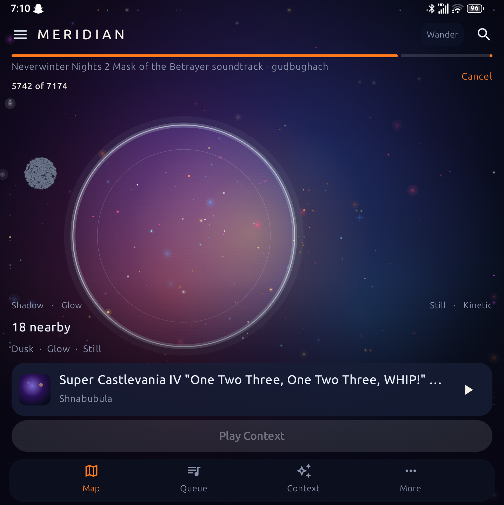
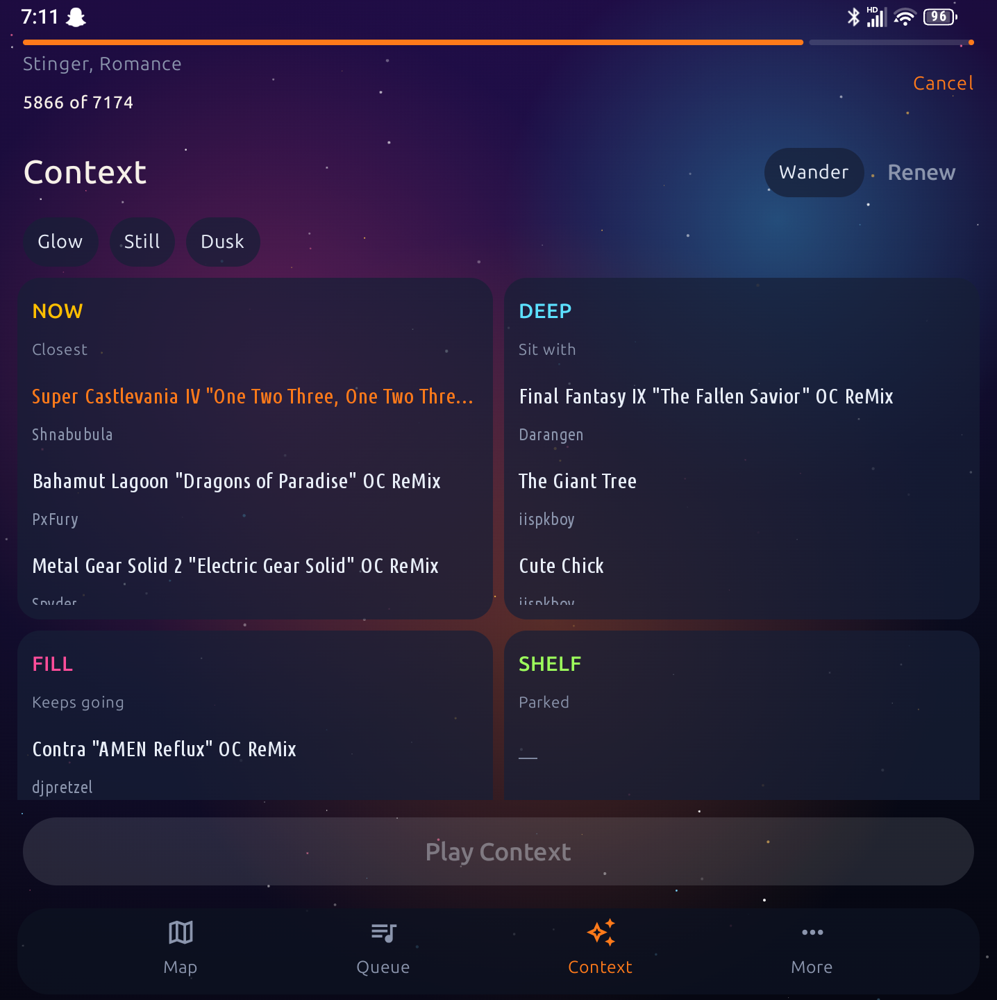
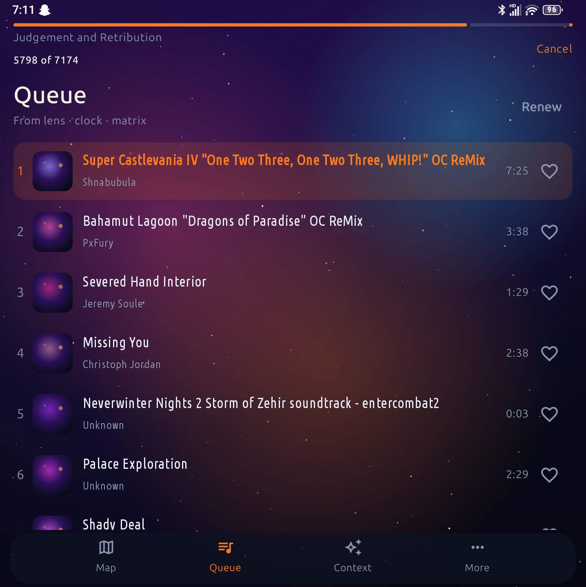
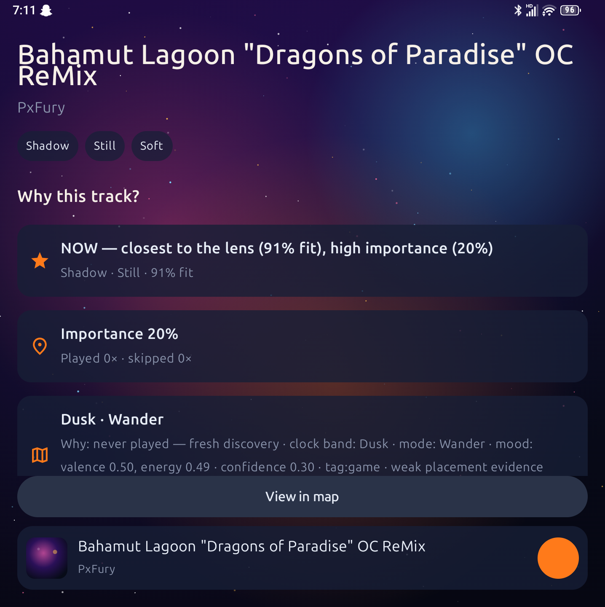
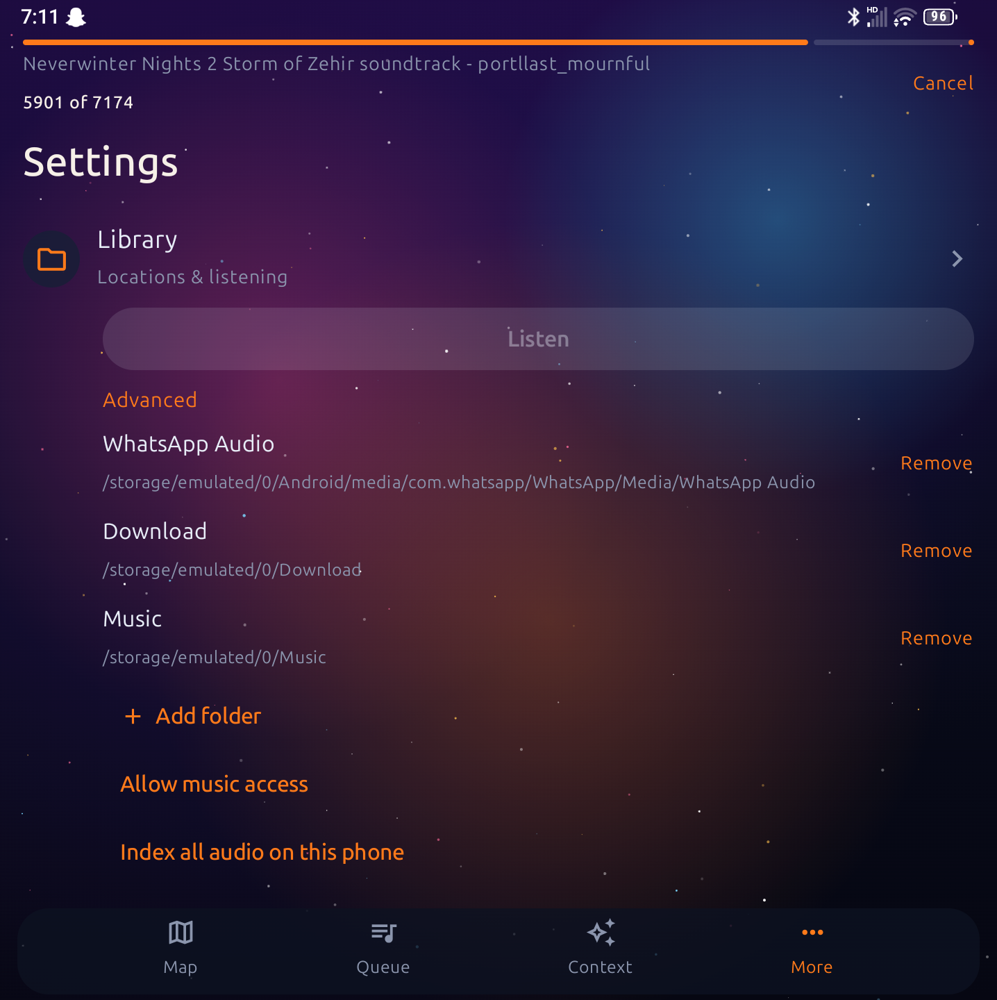

# Meridian

[](LICENSE)
[](https://github.com/dark1ltg/Meridian-Android/releases/tag/v1.3.6)
[](https://github.com/dark1ltg/Meridian-Android/releases/tag/v1.3.6)

**Your library is a night sky. Navigate by feel.**

Meridian is a **local, offline** music player for Android. Every track becomes a star on a mood map — **Shadow → Glow**, **Still → Kinetic**. Aim a lens where you want to be; a context queue builds from that neighborhood. No accounts. No streaming. Your files stay on the phone.

<p align="center">
  
</p>

---

## Screens

| Context matrix | Queue |
|:---:|:---:|
|  |  |
| **Why this track** | **Library** |
|  |  |

---

## Highlights

### Mood map
Your library as a nebula. Pan the empty sky, aim the lens by dragging the ring, pinch inside to tighten the neighborhood, pinch outside to dig in up to ~5× toward your fingers. Zoomed-in titles appear and stagger when stars pack tight. The ring tracks at display refresh so aiming stays smooth on Titan-class screens.

### Listen & place
Meridian takes a short listen of each song (intro / mid / late), then places it honestly on the map — the same mood math as the [Linux desktop app](https://github.com/dark1ltg/Meridian). Tags help; waveform decides. After you allow music access, Scan and Listen run for you. Play, skip, and the map keep working while Listen is running.

### Context queue
Point the lens, then play what lives there. **Renew** rebuilds the queue from the current listen matrix (not shuffle). **Play Context** syncs a stale queue to where you’re aiming without restarting the song that’s already playing. Modes — Focus, Wander, Charge, Dim — steer how adventurous the next picks feel.

### Matrix on the sky
The Context tab shows NOW / DEEP / FILL / SHELF bands over the night sky — what’s close to the lens, what deepens the set, what fills gaps, what’s on the shelf.

### Playback that stays with you
~3s dual-deck crossfade between tracks. Now Playing Previous / Next, lockscreen, and notification controls all move the queue. Skip, previous, and finish teach the map without leaving the phone. Play after a cold start loads the last current track.

### Your folders, your grants
Allow Music / MediaStore, or add folders with the system picker (SAF). Folder-only libraries still open after a cold start. Remove a folder and its tracks and grant leave with it. Unreadable files are skipped until a playable one opens. Shared-storage tracks keep artist, album, and duration. Import warns if a tree is larger than 50,000 files.

### Honest “why”
Queue reasons use fit, importance, love, pins, play/skip history, time of day, and mode — so you can see why a track showed up.

### Private by design
Offline only. No telemetry, no account, no cloud sync. GPL-3.0.

---

## Get the app

**Current release:** [v1.3.6](https://github.com/dark1ltg/Meridian-Android/releases/tag/v1.3.6) · **versionCode 154** · arm64-v8a · Android 8.0+

| | |
|---|---|
| **APK** | [`Meridian-1.3.6-arm64.apk`](https://github.com/dark1ltg/Meridian-Android/releases/download/v1.3.6/Meridian-1.3.6-arm64.apk) (~36.2 MB) |
| **APK SHA-256** | `954832510cad89ee06a54763ed6c21e833f6f4c8abc61128ceb9913e8e7978aa` ([`.sha256`](https://github.com/dark1ltg/Meridian-Android/releases/download/v1.3.6/Meridian-1.3.6-arm64.apk.sha256)) |
| **Source** | [`Meridian-1.3.6-src.tar.gz`](https://github.com/dark1ltg/Meridian-Android/releases/download/v1.3.6/Meridian-1.3.6-src.tar.gz) (~5.5 MB) |
| **Source SHA-256** | `0f4e30044d2a59cc4e63fea5267f3c4bd49916491265a60571daaa69874dc48d` ([`.sha256`](https://github.com/dark1ltg/Meridian-Android/releases/download/v1.3.6/Meridian-1.3.6-src.tar.gz.sha256)) |

```bash
sha256sum -c Meridian-1.3.6-arm64.apk.sha256
adb install -r Meridian-1.3.6-arm64.apk
```

On the phone: open the APK and allow install from that source if asked. Aimed at Unihertz Titan 2–class hardware and modern arm64 phones.

What’s new in each build: **[CHANGELOG](CHANGELOG.md)** · release notes on the [Releases](https://github.com/dark1ltg/Meridian-Android/releases) page.

Linux AppImages stay on [dark1ltg/Meridian](https://github.com/dark1ltg/Meridian/releases).

---

## Build

Needs **JDK 17+**, Android SDK (platform **34**, build-tools, NDK), and network the first time (Chaquopy + pip wheels).

```bash
cp android/local.properties.example android/local.properties
# edit sdk.dir=

cd android
./gradlew :app:assembleDebug
adb install -r app/build/outputs/apk/debug/app-debug.apk
```

Release / arm64 recipe and Listen/FFmpeg notes: **[docs/android.md](docs/android.md)**.

This tree is the Android app (Kotlin / Compose, Media3, Chaquopy) plus the shared `meridian/` Python engine used by desktop.

---

## Documentation

| | |
|---|---|
| [Android port](docs/android.md) | SDK, permissions, Listen pipeline, install |
| [How Meridian listens](docs/audio-analysis-pipeline.md) | Short listen of each track |
| [How stars get placed](docs/placement-pipeline.md) | Tags + listen → mood map |
| [Docs index](docs/README.md) | Requirements and guide list |
| [Changelog](CHANGELOG.md) | Release history |

---

## License

**GNU General Public License v3.0** — see [LICENSE](LICENSE) / [COPYING](COPYING).

Third-party notices: [THIRD_PARTY_NOTICES.txt](THIRD_PARTY_NOTICES.txt).  
Ubuntu Sans / Condensed ship under the Ubuntu Font Licence 1.0 in `resources/fonts/`.  
Source offer for the APK: [SOURCE_OFFER.txt](SOURCE_OFFER.txt).
